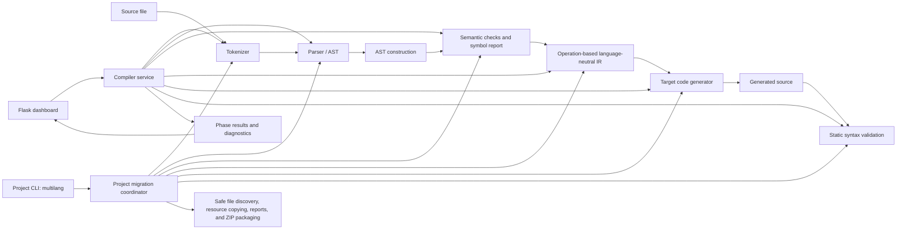

# Architecture

`preprocessor.py` accepts a small set of standard C headers and rejects other directives. `lexer.py` emits positioned tokens, `parser.py` builds AST nodes from the deliberately small shared syntax, and `semantic.py` checks supported declarations, names, arrays, constants, and function calls. Phase 4 displays the actual `Program`/`Stmt`/`Expr` AST as an indented node tree. Phase 5 returns the checks actually performed plus declaration and function metadata. `ir.py` lowers the AST to version 2 named operations such as `DECLARE_VARIABLE`, `BINARY_OPERATION`, `OUTPUT`, and `BRANCH`; this is structurally different from the AST. `restore()` maps those operations back to compiler nodes so the existing C, Python, and JavaScript generators remain reusable. The IR is a small operation-oriented educational IR, not machine code or an optimizing SSA/three-address IR. `errors.py` provides phase and line diagnostics. No stage executes input.

`webapp/compiler_service.py` calls those same compiler modules and records phase outputs. `webapp/app.py` exposes JSON endpoints and serves the page. The browser app is plain HTML/CSS/JavaScript with an accessible syntax-colored textarea editor. `multilang_transpiler/project_migration.py` discovers and translates files independently using the same preprocessing, lexer, parser, semantic analyzer, IR, and generators. `project_cli.py` provides the `multilang` command; `validation.py` performs static syntax checks and is shared by the CLI and dashboard. Project output is built in a temporary sibling directory, its ZIP is checked, then destinations are finalized. The CLI does not resolve imports, link files, or execute source/generated programs.

Validation parses generated Python and invokes `node --check` or a C `-fsyntax-only` command if installed. No server endpoint executes a source or generated program.
